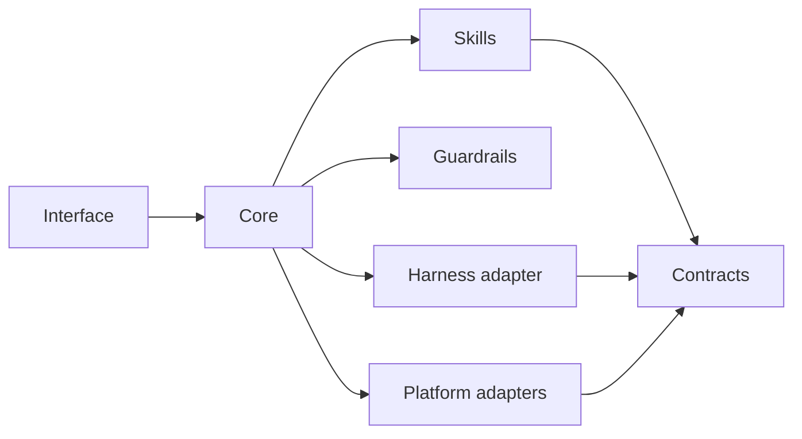

# Harness Architecture

A reference architecture for AI systems that stay useful across models, platforms, and time.

This repository is design-first. The runnable example is [token-frugal-harness](https://github.com/ControlSquare/token-frugal-harness).

> The core owns the work. Models, platforms, and skills are replaceable edges.

## Why this exists

Most AI systems are built around one model, one publishing platform, and one happy path. The first provider change, platform change, or bad output exposes the coupling.

This architecture separates the parts that change from the parts that should not:

- **Core:** orchestration, policy, state transitions, review
- **Skills:** versioned capabilities with input and output contracts
- **Adapters:** model harnesses and platforms
- **Guardrails:** deterministic checks and human approval
- **State:** files, not conversations

## Principles

1. **The core imports no vendor SDK.** Provider code lives in adapters.
2. **State lives in files.** The queue, archive, and run record survive the process.
3. **Skills are contracts.** A skill declares inputs, outputs, permissions, and failure behavior.
4. **Guardrails are deterministic.** Checks that can be scripts are scripts.
5. **Human review is a product requirement.** Automation stops before the decision.

## Package map



## Repository map

```
docs/
  01-package-boundaries.md
  02-contracts.md
  03-content-degradation.md
  04-harness-adapters.md
  05-platform-adapters.md
  06-skills.md
  07-failure-modes.md
  08-observability.md
  decisions/
contracts/
  skill.schema.json
  platform-adapter.schema.json
examples/
  skill.research-brief.json
  adapter.substack.json
scripts/
  check_contracts.py
tests/
  test_contracts.py
```

## What this is not

- Not a framework you install.
- Not a claim that every platform is interchangeable.
- Not client code, client content, or a production deployment.
- Not a replacement for judgment.

The interfaces are intentionally small. Adapt them to the system you are building.

## Related

- [Token-frugal reference implementation](https://github.com/ControlSquare/token-frugal-harness)
- [AI publishing case study](https://controlsquare.com/work/ai-publishing-harness)
- [AI automation at Control Square](https://controlsquare.com/ai-automation)
- [Work](https://controlsquare.com/work/)

## License

MIT. See [LICENSE](LICENSE).
