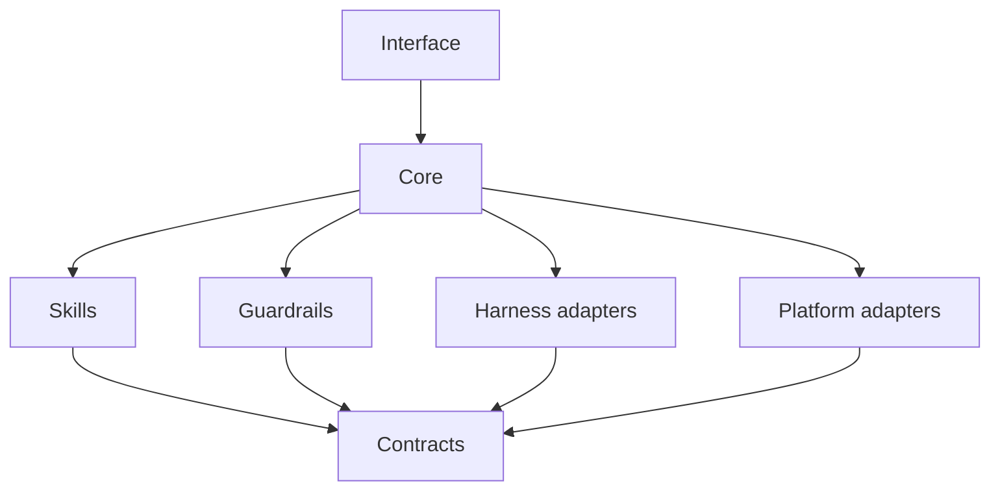

# Package boundaries

The architecture is five packages with one direction of dependency.



## What each package owns

| Package | Owns | Must not own |
| --- | --- | --- |
| Core | Orchestration, policy, state transitions, review handoff | Vendor SDKs, platform calls, prompt text for one provider |
| Skills | One capability and its input/output contract | Credentials, UI, direct database access |
| Guardrails | Deterministic checks and pass/fail results | Rewriting the work, model calls |
| Harness adapters | Model transport, tools, usage, errors | Business rules, publishing, client data |
| Platform adapters | Publish, store, image, search operations | Orchestration, prompts, review policy |
| Contracts | Schemas and shared types | Behavior |

## Dependency rules

1. Core imports contracts only.
2. Skills import contracts only.
3. Adapters import contracts and their vendor SDK. Nothing imports an adapter except the composition root.
4. Guardrails are pure functions over inputs and files.
5. The interface talks to core, never to an adapter directly.

A violation is visible in review: if a core file imports a vendor package, the boundary has failed.

## Why isolate this way

The parts that change most often are the model provider and the publishing platform. The parts that should change least are the policy, the review gate, and the state model. If those are coupled, every provider change becomes a rewrite.

Isolation also makes testing possible. A fake harness adapter and a fake publishing adapter can exercise the entire core without a network call.

## Isolation tactics

- **Contract tests.** Every adapter passes the same suite. A provider can change without breaking the core.
- **Capability flags.** An adapter declares what it supports. The core branches on capabilities, not vendor names.
- **No shared mutable state.** State lives in files, not module globals or a long-lived conversation.
- **Composition at the edge.** One entry point wires the core to concrete adapters. The rest of the code sees interfaces.
- **Fail closed.** An adapter that cannot prove a write succeeded returns an error, not a guess.

## Package tree

```text
core/
  orchestrator
  policy
  review
skills/
  manifest
  handlers
guardrails/
  checks
adapters/
  harness/
  platform/
contracts/
  schemas
  types
```

The tree is illustrative. The rule is not: dependencies point inward, and vendor code stays at the edge.
